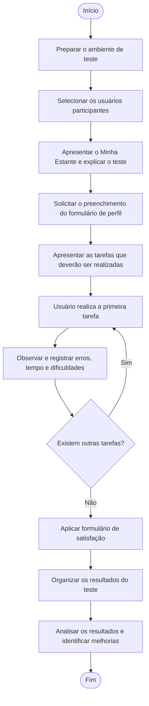

# 13. TESTE DE USABILIDADE

**[1 solução completa por pessoa da equipe]**

**Método de Avaliação de Usabilidade por Observação do Usuário**  
**(o número de usuários observados é igual o número de membros da equipe)**

## 1) Fluxograma de Avaliação de Usabilidade por Observação do Usuário [1 solução por equipe]

## 2) DESCRIÇÃO DO PROCEDIMENTO DE PREPARAÇÃO DO TESTE [1 solução por equipe]

**Passo 1: Preparação do ambiente de teste.**

O teste será realizado utilizando o protótipo do sistema Minha Estante, uma plataforma digital voltada à organização de livros, acompanhamento de leituras e compartilhamento de resenhas.

O usuário deverá acessar o sistema por meio de um computador ou dispositivo compatível, utilizando um navegador atualizado. O ambiente deverá permitir a navegação pelas telas disponíveis no protótipo.

Durante a avaliação, um integrante da equipe ficará responsável por observar o comportamento do participante e registrar o tempo necessário, as dificuldades encontradas, os erros cometidos e o grau de sucesso na realização das tarefas.

**Passo 2: Lista de tarefas que o usuário deve cumprir.**

O participante deverá realizar as seguintes tarefas no Minha Estante:

1. Acessar a tela inicial do Minha Estante e localizar a opção de login ou cadastro.
2. Localizar um livro utilizando a funcionalidade de busca.
3. Adicionar um livro à sua estante pessoal.
4. Localizar um livro na estante e identificar seu status de leitura.
5. Consultar o progresso de leitura.
6. Localizar a área destinada às resenhas e avaliações dos livros.
7. Acessar o perfil do usuário e identificar as informações disponíveis.

**Passo 3: Formulário de perfil do usuário**

Antes de iniciar o teste, o participante deverá responder a um formulário para identificação de seu perfil e familiaridade com plataformas digitais de leitura.

Perguntas sugeridas:

1. Qual é a sua faixa etária?
2. Você costuma ler livros digitais?
3. Com que frequência você utiliza aplicativos ou sites de leitura?
4. Você já utilizou plataformas para organizar seus livros?
5. Você costuma escrever ou consultar resenhas de livros?
6. Você considera fácil utilizar novos sistemas e aplicativos?

**Passo 4: Orientação para realização do teste.**

O participante receberá as instruções necessárias para realizar as tarefas, sem receber orientações sobre onde clicar ou como executar cada ação.

O avaliador deverá observar a navegação naturalmente, evitando interferir nas decisões do usuário.

**Passo 5: Registro das informações.**

Durante a execução das tarefas, serão registrados:

- Grau de sucesso na realização de cada tarefa.
- Quantidade total de erros cometidos.
- Tipos de erros identificados.
- Tempo necessário para concluir cada tarefa.
- Grau de satisfação ou dificuldade demonstrado pelo participante.

**Passo 6: Aplicação do formulário de satisfação.**

Após concluir as tarefas, o participante deverá responder a perguntas sobre sua experiência de utilização do Minha Estante, considerando a facilidade de navegação, organização das informações, compreensão das funcionalidades e satisfação geral.

## 3) RESULTADOS DO TESTE [1 solução por equipe]

**Avaliação de cada Tarefa (para cada usuário)**

| Tarefa | Grau de Sucesso | Total de Erros cometidos | Tipos de Erros | Tempo Necessário | Grau de Satisfação |
| ----- | ----- | ----- | ----- | ----- | ----- |
| **1 – Acessar login ou cadastro** | A preencher | A preencher | A preencher | A preencher | A preencher |
| **2 – Buscar um livro** | A preencher | A preencher | A preencher | A preencher | A preencher |
| **3 – Adicionar um livro à estante** | A preencher | A preencher | A preencher | A preencher | A preencher |
| **4 – Identificar o status de leitura** | A preencher | A preencher | A preencher | A preencher | A preencher |
| **5 – Consultar o progresso de leitura** | A preencher | A preencher | A preencher | A preencher | A preencher |
| **6 – Localizar resenhas e avaliações** | A preencher | A preencher | A preencher | A preencher | A preencher |
| **7 – Acessar o perfil do usuário** | A preencher | A preencher | A preencher | A preencher | A preencher |

**Links dos vídeos:**

- Usuário 1: [Inserir link da gravação]
- Usuário 2: [Inserir link da gravação]
- Usuário 3: [Inserir link da gravação]
- Demais participantes: [Inserir links, conforme o número de integrantes da equipe]

**Respostas do Formulário do Usuário:**

As respostas dos formulários preenchidos pelos participantes deverão ser inseridas nesta seção, identificando cada usuário e apresentando suas respostas sobre o perfil, experiência de utilização e satisfação com o Minha Estante.

- Usuário 1: [Inserir respostas do formulário]
- Usuário 2: [Inserir respostas do formulário]
- Usuário 3: [Inserir respostas do formulário]
- Demais participantes: [Inserir respostas, conforme o número de integrantes da equipe]

**Conclusão da avaliação por observação do usuário:**

A avaliação de usabilidade por observação do usuário tem como objetivo analisar a experiência dos participantes durante a utilização do Minha Estante, identificando dificuldades de navegação, problemas de compreensão e possíveis obstáculos na realização das tarefas propostas.

A partir dos resultados obtidos, será possível avaliar se as funcionalidades de busca de livros, organização da estante pessoal, acompanhamento do progresso de leitura, consulta de resenhas e acesso ao perfil são compreendidas pelos usuários.

Os dados coletados durante os testes permitirão identificar os pontos positivos do sistema e as funcionalidades que precisam de melhorias, contribuindo para tornar o Minha Estante mais intuitivo, acessível e eficiente.

A conclusão definitiva deverá ser elaborada após a realização dos testes, considerando os resultados observados, os erros registrados, o tempo de execução das tarefas e as opiniões dos participantes.
