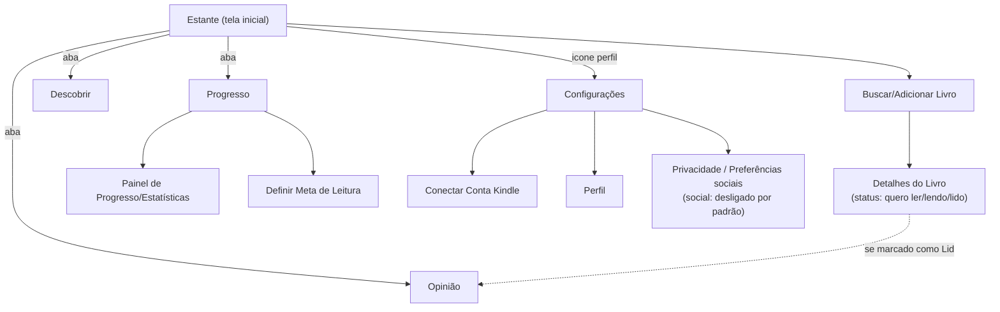
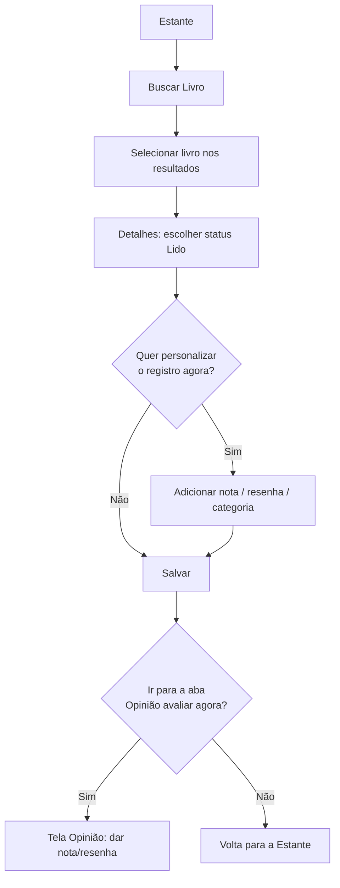
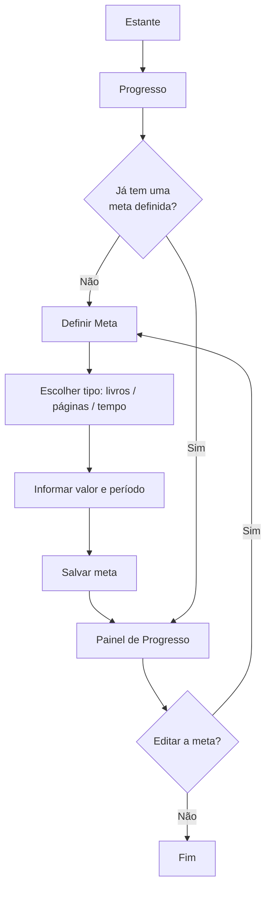
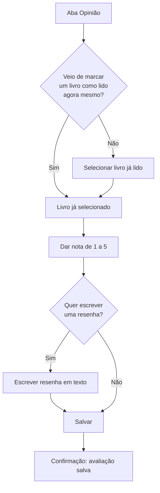
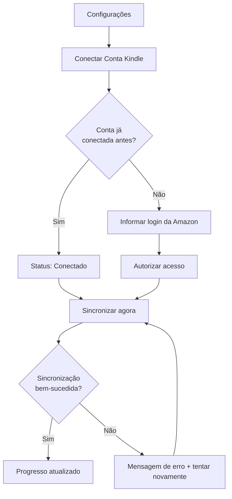

# Arquitetura de Informação e Fluxo do Usuário

## 1) Arquitetura de Informação (Sitemap)

**Telas principais identificadas:**

- Estante (tela inicial) — lista de livros, com atalho "+" para adicionar
  - Buscar/Adicionar Livro
  - Detalhes do Livro
- Progresso
  - Painel de Progresso e Estatísticas
  - Definir Meta de Leitura
- Opinião — avaliação e resenha dos livros lidos
- Descobrir — recomendações personalizadas
- Configurações (acessada pelo ícone de perfil, não é aba principal)
  - Conectar Conta Kindle
  - Perfil
  - Privacidade / Preferências sociais (funcionalidades sociais desligadas por padrão)

**Justificativa da organização**: a hierarquia segue diretamente os clusters encontrados na classificação de cartões (`resultados_classificacao_cartoes.md`), não uma estrutura arbitrária da equipe:

- **Estante** é a tela inicial e reúne o registro básico (buscar, ver status lido/lendo/quero ler), pois o cluster "Registrar lido + Registrar lendo" foi o mais unânime entre os 4 participantes (4 de 4) — é o que a pessoa mais faz, então vira a porta de entrada do app.
- **Opinião** foi elevada a **aba principal de navegação** (não uma sub-tela dentro de Estante), porque o cluster "Avaliar + Resenha + Anotações" foi o segundo mais forte da pesquisa (3 de 4 participantes) — forte o bastante para merecer visibilidade de primeiro nível, não ficar escondido dentro de outra seção.
- **Progresso** agrupa painel e meta, pois "Progresso + Estatísticas" foi, na prática, o cluster mais unânime de todos (4 de 4). A definição da meta fica como sub-tela aqui, mas o valor definido também aparece resumido na Estante, já que "meta" foi o item mais "flutuante" da pesquisa (cada participante a associou a um cluster diferente).
- **Configurações não é uma aba principal** — fica atrás do ícone de perfil, seguindo o padrão de apps mobile para itens de baixa frequência de uso, e é ali que mora a funcionalidade social, **desligada por padrão**: o questionário mostrou baixo interesse (itens sociais nas últimas posições de prioridade) e 1 dos 4 participantes do card sorting rejeitou essa funcionalidade explicitamente.
- **Descobrir** (recomendações) ficou como aba própria, já que não teve "casa" fixa na classificação de cartões (cada participante a colocou em um lugar diferente) — resolvido dando a ela visibilidade própria em vez de escondê-la dentro de outra seção.

## 2) Fluxo do Usuário (User Flow)

### Fluxo 1 — Registrar um livro como lido

**Funcionalidade e objetivo do usuário**: permitir que o usuário busque um livro e o marque como lido rapidamente, com a opção (não obrigatória) de personalizar o registro com nota, resenha ou categoria. Atende diretamente à dor mais citada na pesquisa: abandono de apps por excesso de etapas de cadastro (persona Yasmin).

- **Atalho**: o caminho E → Não → F é o atalho intencional de menos toques, priorizado no design pela meta de usabilidade de 40% (facilidade de registro rápido).
- **Caminho alternativo**: a partir de H, o usuário pode ir direto para a aba **Opinião** (Fluxo 3) sem precisar navegar manualmente até lá.

### Fluxo 2 — Definir e acompanhar uma meta de leitura

**Funcionalidade e objetivo do usuário**: permitir que o usuário estabeleça uma meta (livros, páginas ou tempo) e veja claramente seu progresso em relação a ela. Atende à dor central da persona Camila (perde a contagem manual da própria meta).

- **Atalho**: usuários que já têm meta definida (C → Sim) vão direto ao Painel, sem repassar pela definição.
- **Caminho alternativo**: a edição da meta (I → Sim) reaproveita a mesma tela de definição (D), evitando duplicar interface.

### Fluxo 3 — Avaliar e escrever uma resenha de um livro

**Funcionalidade e objetivo do usuário**: permitir registrar uma nota (1 a 5) e, opcionalmente, uma resenha em texto sobre um livro já lido. Atende ao desejo de registrar opinião pessoal, citado por 3 das 5 entrevistadas.

- **Atalho**: quando o usuário vem direto do Fluxo 1 (acabou de marcar como lido), o livro já chega pré-selecionado — não precisa buscar de novo.
- **Caminho de erro/saída**: o usuário pode sair da tela de resenha (G) sem salvar; nesse caso, apenas a nota (E) é mantida — nunca se perde o que já foi preenchido antes.

### Fluxo 4 — Sincronizar o progresso de leitura com o Kindle

**Funcionalidade e objetivo do usuário**: permitir que o usuário conecte sua conta Kindle e importe o progresso automaticamente, evitando manter dois sistemas separados. Atende à dor central da persona secundária Letícia.

- **Atalho**: contas já conectadas (C → Sim) pulam direto para a sincronização, sem repetir login.
- **Estado de erro explícito**: modelado porque a instabilidade técnica foi a dor central relatada por Letícia em relação ao concorrente — o fluxo precisa lidar com falha de forma clara, sem deixar o usuário sem saber o que aconteceu.
