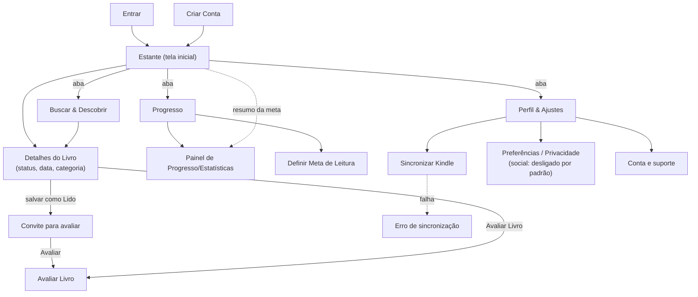
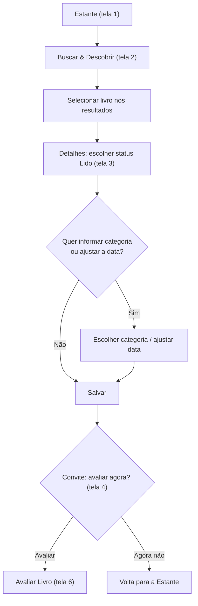
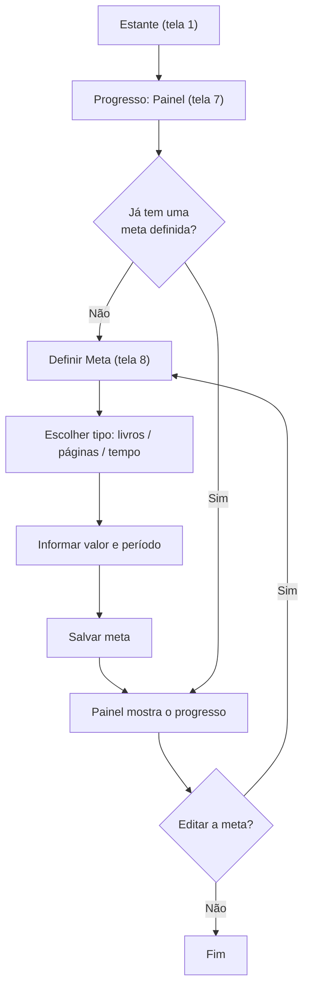
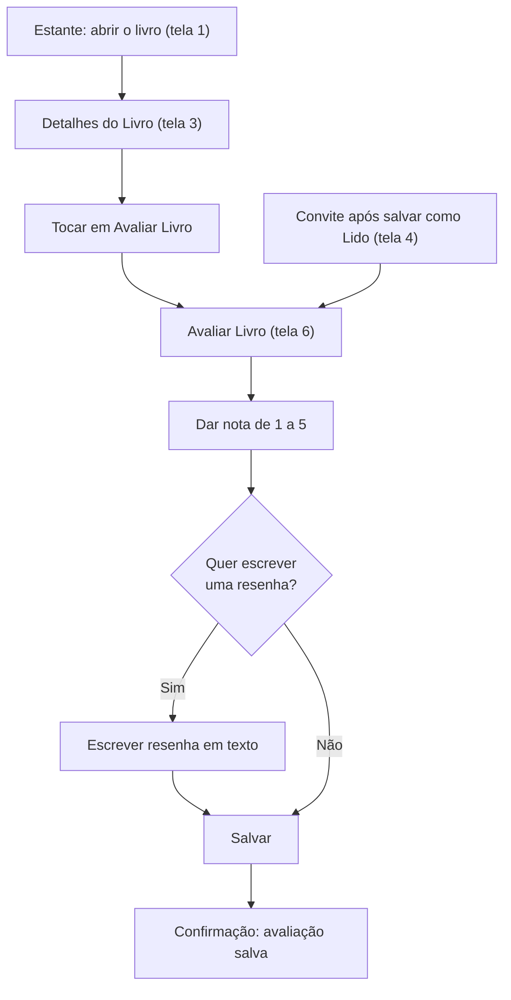
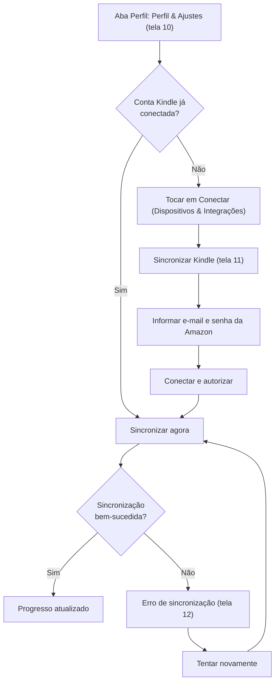

# Arquitetura de Informação e Fluxo do Usuário

> **Nota de revisão:** esta versão foi atualizada para refletir o protótipo de alta fidelidade (Figma): a aba "Opinião" foi descontinuada (a avaliação é acessada pelo botão "Avaliar Livro" na tela Detalhes e pelo convite após marcar como Lido), "Descobrir" foi fundida a "Buscar & Descobrir", "Configurações" passou a ser a aba **Perfil**, e foram adicionadas as telas de Entrar e Criar Conta.

## 1) Arquitetura de Informação (Sitemap)

**Telas principais identificadas** (navegação inferior com 4 abas: Estante, Progresso, Buscar, Perfil):

- Entrada
  - Entrar (login)
  - Criar Conta
- Estante (tela inicial) — lista de livros, resumo da meta e atalho "Adicionar livro"
  - Detalhes do Livro (status, data e categoria opcional; botão "Avaliar Livro")
  - Convite para avaliar (aparece após salvar um livro como Lido)
  - Avaliar Livro (nota e resenha)
- Progresso
  - Painel de Progresso e Estatísticas
  - Definir Meta de Leitura
- Buscar & Descobrir — busca por título ou ISBN e recomendações personalizadas, com o motivo de cada sugestão
- Perfil (aba principal)
  - Sincronizar Kindle (login e autorização)
  - Erro de sincronização
  - Preferências / Privacidade (funcionalidades sociais desligadas por padrão)
  - Conta e suporte

### Mapa de telas

| Nº | Tela | Arquivo (wireframe) | Fluxos | Frame no Figma |
| :---: | :---- | :---- | :---- | :---- |
| 1 | Estante | `01_estante.png` | 1, 2, 3 | Estante (e Estante vazia) |
| 2 | Buscar & Descobrir | `02_buscar_livro.png` | 1 | Buscar & Descobrir (e Buscar sem resultados) |
| 3 | Detalhes do Livro | `03_detalhes_livro.png` | 1, 3 | Detalhes do Livro |
| 4 | Convite para avaliar | `04_confirmacao_avaliar.png` | 1, 3 | Convite para avaliar |
| 5 | Opinião — lista | `05_opiniao_lista.png` | — | Descontinuada |
| 6 | Avaliar Livro | `06_avaliar_resenhar.png` | 1, 3 | Avaliar & Resenhar |
| 7 | Painel de Progresso | `07_painel_progresso.png` | 2 | Progresso (e Progresso vazio) |
| 8 | Definir Meta | `08_definir_meta.png` | 2 | Metas de Leitura |
| 9 | Descobrir | `09_descobrir.png` | — | Fundida à tela 2 |
| 10 | Perfil & Ajustes | `10_configuracoes.png` | 4 | Perfil & Ajustes (e Perfil vazio) |
| 11 | Sincronizar Kindle | `11_kindle_login.png` | 4 | Sincronizar Kindle (conectado e desconectado) |
| 12 | Erro de sincronização | `12_kindle_erro.png` | 4 | Erro de sincronização |
| 13 | Entrar (login) | — | — | Entrar |
| 14 | Criar Conta | — | — | Criar Conta |

**Wireframes desatualizados:** os wireframes 02, 05, 09 e 10 e a barra de navegação inferior dos wireframes antigos não refletem a estrutura atual (4 abas: Estante, Progresso, Buscar, Perfil).

**Estados ainda não desenhados** (a tratar no protótipo do Figma): Detalhes do Livro no estado "Lido" e a tela de login da Amazon. Os estados vazios, Kindle conectado/desconectado, sincronização concluída e erro já existem no protótipo.

**Funcionalidades sociais**: no protótipo existe apenas o interruptor em Perfil (deve ficar desligado por padrão). As telas sociais em si ficam fora do escopo da primeira versão testável, coerente com o baixo peso (10%) dessa meta em `7_requisitos_ux.md`.

**Justificativa da organização**: a hierarquia segue os clusters encontrados na classificação de cartões (`resultados_classificacao_cartoes.md`), não uma estrutura arbitrária da equipe:

- **Estante** é a tela inicial e reúne o registro básico (buscar, ver status lido/lendo/quero ler), pois o cluster "Registrar lido + Registrar lendo" foi unânime entre os 4 participantes (4 de 4) — é o que a pessoa mais faz, então vira a porta de entrada do app.
- **Avaliação** não é uma aba própria: o cluster "Avaliar + Resenha + Anotações" (3 de 4 participantes) é atendido pelo botão "Avaliar Livro" na tela Detalhes e pelo convite logo após marcar como Lido, mantendo a avaliação junto ao livro e a navegação principal enxuta.
- **Progresso** agrupa painel e meta, pois "Progresso + Estatísticas" foi também unânime (4 de 4). A definição da meta fica como sub-tela aqui, mas o valor definido também aparece resumido na Estante, já que "meta" foi o item mais "flutuante" da pesquisa (cada participante a associou a um cluster diferente).
- **Buscar & Descobrir** reúne busca e recomendações numa só aba: "Descobrir" não teve "casa" fixa na classificação de cartões (cada participante a colocou em um lugar diferente), e juntá-la à busca a mantém visível sem ocupar uma aba. Cada sugestão mostra o **motivo** da recomendação, já que a pesquisa indicou que a confiança depende da justificativa.
- **Perfil** é aba principal, o que dá visibilidade à conexão com o Kindle (função central da persona Letícia) e às preferências. É ali que mora a funcionalidade social, **desligada por padrão**: o questionário mostrou baixo interesse em social (itens sociais nas últimas posições) e 1 dos 4 participantes do card sorting rejeitou essa funcionalidade explicitamente.

## 2) Fluxo do Usuário (User Flow)

### Fluxo 1 — Registrar um livro como lido

**Funcionalidade e objetivo do usuário**: permitir que o usuário busque um livro e o marque como lido rapidamente, com a opção (não obrigatória) de informar categoria e data, e de avaliar logo em seguida. Atende diretamente à dor mais citada na pesquisa: abandono de apps por excesso de etapas de cadastro (persona Yasmin).

- **Atalho**: o caminho E → Não → F é o atalho intencional de menos toques, priorizado no design pela meta de usabilidade de **30%** (facilidade e confiabilidade do registro básico, a maior da tabela em `7_requisitos_ux.md`).
- **Caminho alternativo**: a partir de H, o usuário vai direto para a avaliação (Fluxo 3) sem navegar manualmente; "Agora não" mantém o livro na Estante, e a avaliação pode ser feita depois pelo botão "Avaliar Livro" na tela Detalhes.

### Fluxo 2 — Definir e acompanhar uma meta de leitura

**Funcionalidade e objetivo do usuário**: permitir que o usuário estabeleça uma meta (livros, páginas ou tempo) e veja claramente seu progresso em relação a ela. Atende à dor central da persona Camila (perde a contagem manual da própria meta).

- **Atalho**: o resumo da meta na Estante leva direto ao Painel; usuários que já têm meta (C → Sim) não repassam pela definição.
- **Caminho alternativo**: o botão "Editar meta" do Painel reaproveita a mesma tela de definição (8), evitando duplicar interface.

### Fluxo 3 — Avaliar e escrever uma resenha de um livro

**Funcionalidade e objetivo do usuário**: permitir registrar uma nota (1 a 5) e, opcionalmente, uma resenha em texto sobre um livro já lido. Atende ao desejo de registrar opinião pessoal, citado por 3 das 5 entrevistadas.

- **Atalho**: quando o usuário vem do convite do Fluxo 1, o livro já chega selecionado — não precisa buscar de novo.
- **Privacidade**: a resenha é privada por padrão; nenhum botão deve sugerir publicação (ver "Ajustes pendentes" em `10_prototipacao_figma.md`).
- **Caminho de saída**: o usuário pode sair da resenha sem salvar ("Pular"); nesse caso, apenas a nota é mantida — nunca se perde o que já foi preenchido antes.

### Fluxo 4 — Sincronizar o progresso de leitura com o Kindle

**Funcionalidade e objetivo do usuário**: permitir que o usuário conecte sua conta Kindle e importe o progresso automaticamente, evitando manter dois sistemas separados. Atende à dor central da persona secundária Letícia.

- **Atalho**: contas já conectadas (B → Sim) pulam direto para a sincronização, sem repetir o login.
- **Estado de erro explícito**: modelado porque a instabilidade técnica foi a dor central relatada por Letícia em relação ao concorrente — o fluxo precisa lidar com falha de forma clara, com mensagem em texto, sem perda de dados e com a opção de tentar de novo.
