# Prototipação de Baixa Fidelidade – Minha Estante

**1. Esboço das principais telas**

Foram desenvolvidos esboços de baixa fidelidade para representar as principais telas do sistema Minha Estante, utilizando desenhos simples em preto e branco.

**2. Fluxos de usuário**

Os esboços contemplam os seguintes fluxos:

- **Adicionar livro:** acessar a busca, pesquisar um livro, visualizar seus detalhes e adicioná-lo à estante.
- **Registrar leitura:** acessar os detalhes do livro, alterar seu status para lido e registrar a data de conclusão.
- **Avaliar livro:** acessar a área Opinião, selecionar um livro ainda não avaliado e registrar uma nota e um comentário.
- **Acompanhar progresso:** visualizar os livros lidos, acompanhar as estatísticas e definir uma meta de leitura.
- **Conectar Kindle:** acessar as configurações, conectar a conta Kindle e realizar a sincronização.

**3. Anexos dos esboços**

### 1. Estante Principal
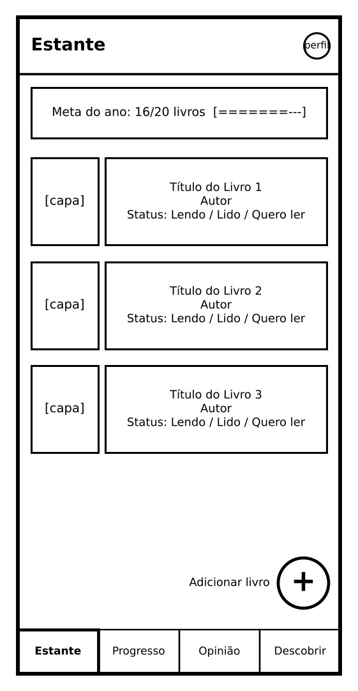

### 2. Buscar Livro
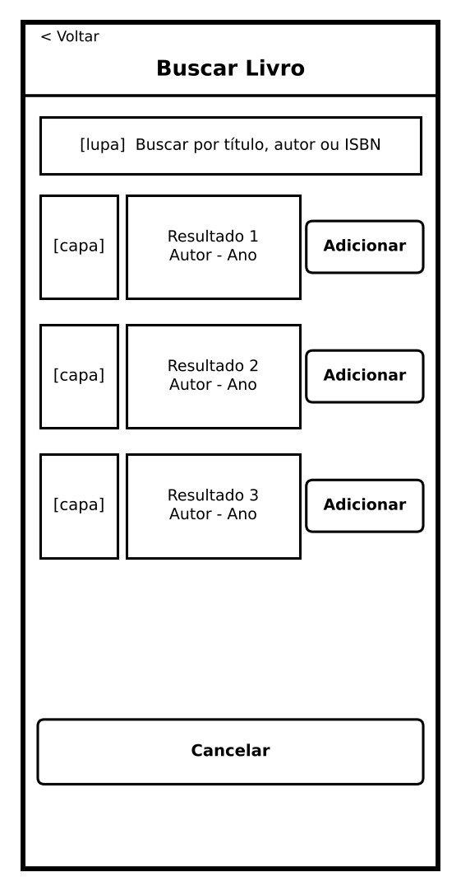

### 3. Detalhes do Livro
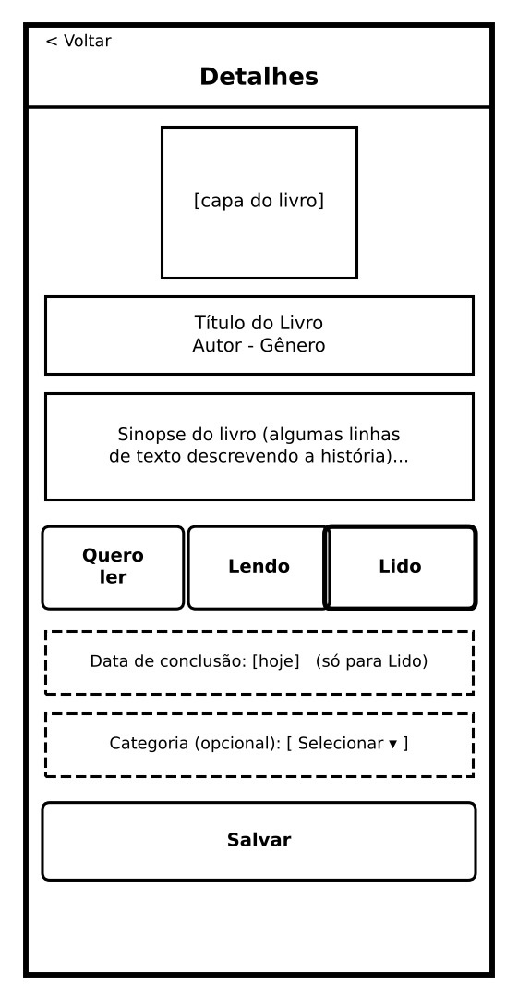

### 4. Livro Lido
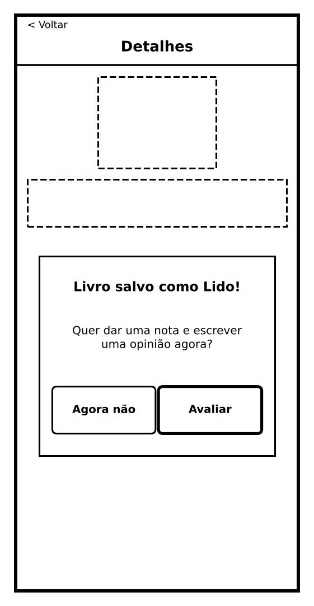

### 5. Avaliar Livro
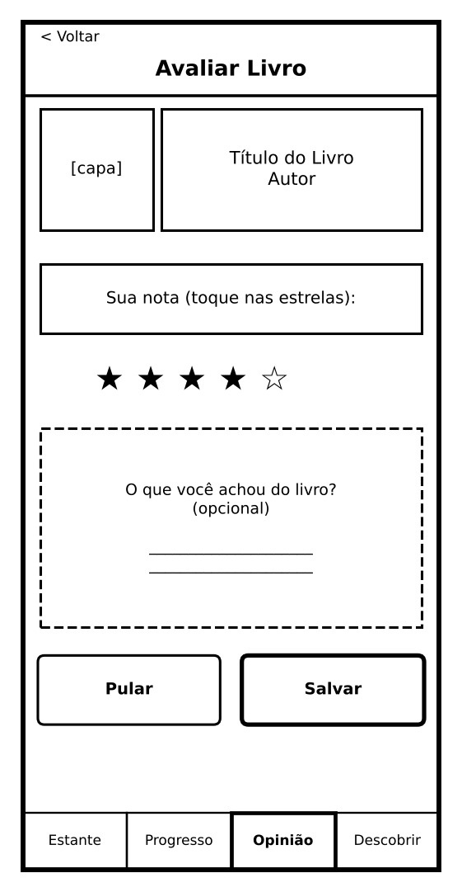

### 6. Opinião
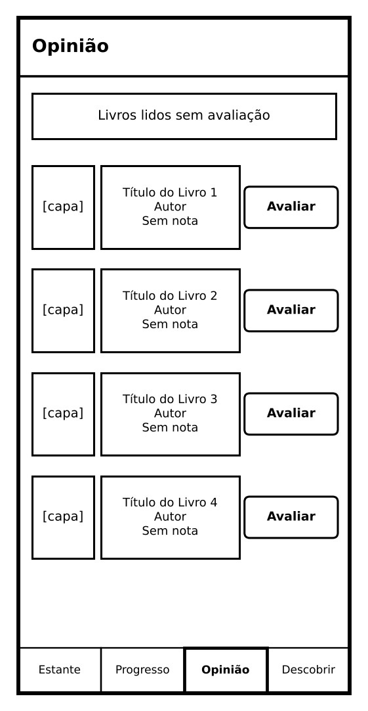

### 7. Meu Progresso
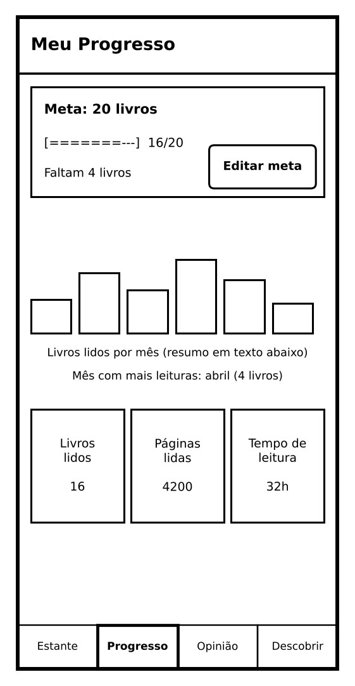

### 8. Definir Meta
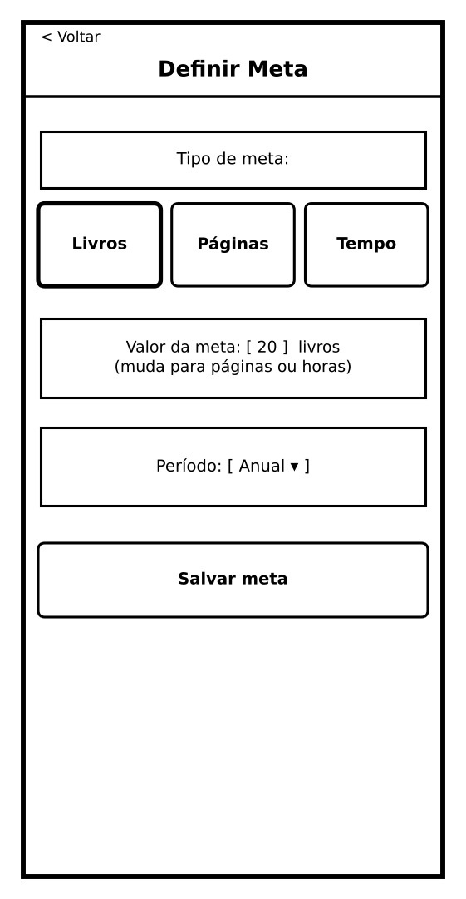

### 9. Descobrir Livros
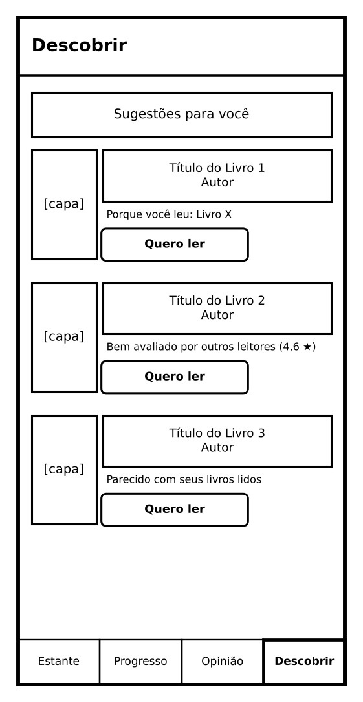

### 10. Configurações
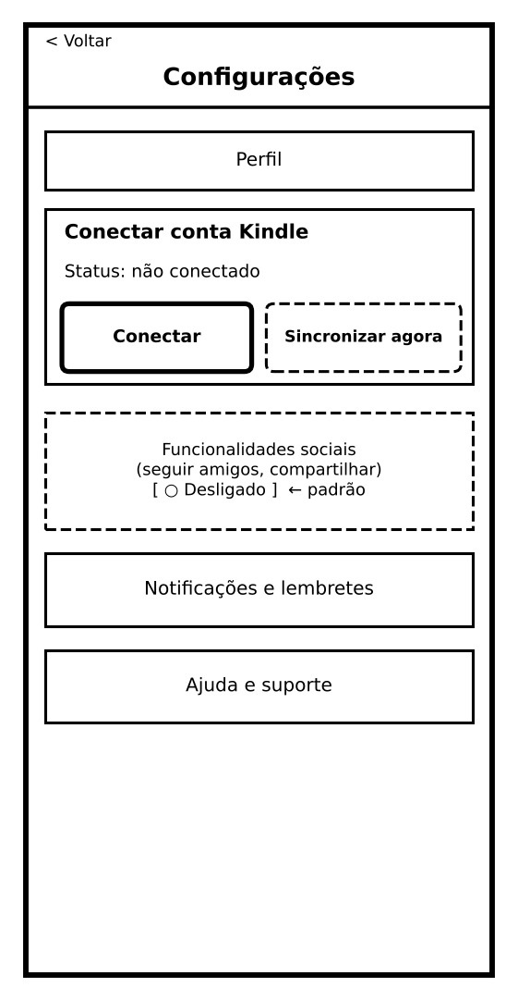

### 11. Conectar Kindle
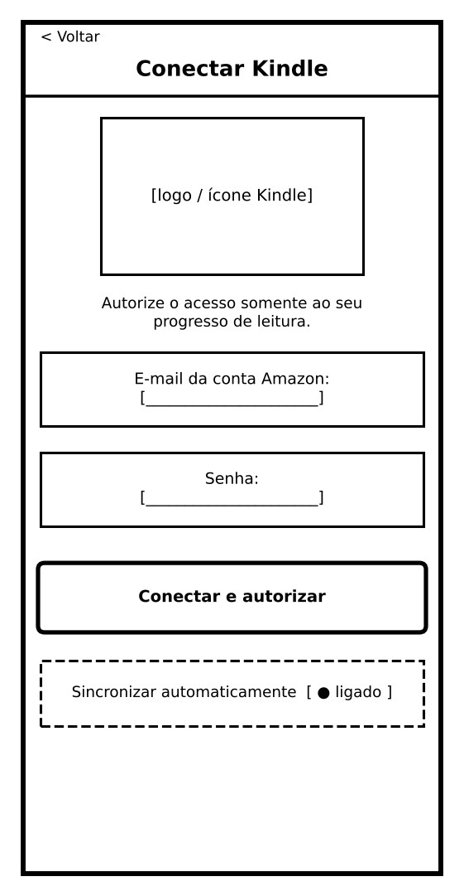

### 12. Erro de Sincronização
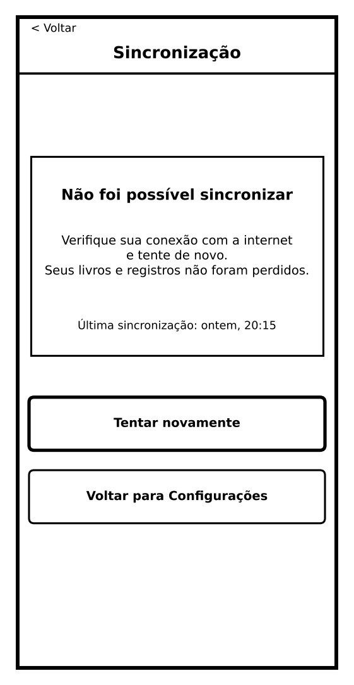

**4. Feedback sobre o protótipo**

'Achei o protótipo muito legal e fácil de entender. As telas estão bem organizadas e as funcionalidades são intuitivas, sendo fácil identificar o que cada botão faz e como navegar pelo aplicativo. Gostei principalmente da ideia de reunir a estante, o acompanhamento do progresso e as avaliações dos livros em um só lugar. Também achei interessante a possibilidade de conectar o Kindle e acompanhar as leituras. No geral, achei a proposta criativa, útil e bem estruturada, e consegui compreender facilmente como o aplicativo funcionaria mesmo sendo apenas um esboço.'

